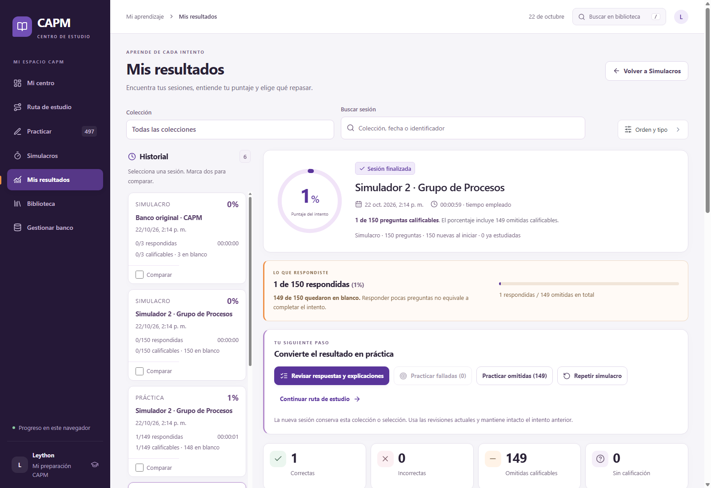
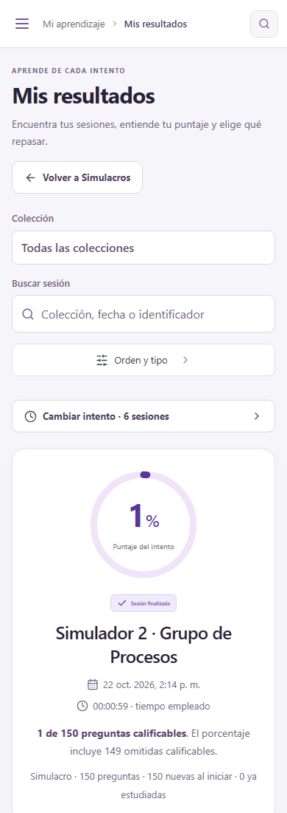

# Verificación del rediseño · 1.4.0

Proyecto probado en Windows, Node 24.14.1, npm 11.11.0 y Chrome, con Vite en http://localhost:5173/.

| Comando | Resultado |
|---|---|
| `npm install --offline` | Correcto; paquetes visuales locales incluidos |
| `npm test` | 64 pruebas aprobadas |
| `npm run build` | TypeScript y producción correctos |
| `npm run audit:bank` | 497 preguntas, 85 fuentes, sin errores |
| `npm run test:design` | 12 grupos aprobados |
| `npm run test:procesos` | 9 grupos aprobados |
| `npm run test:collections` | 13 grupos aprobados |
| `npm run test:browser` | 14 grupos aprobados |
| `npm run test:dev` | 5 grupos aprobados |

En total: 53 grupos de comprobaciones en navegador. El ensayo de producción sirve la compilación en un puerto aislado y se detiene al terminar; el servidor de desarrollo permanece en 5173.

Se respondieron las 150 preguntas de cada simulacro PDF y se comprobaron sus alternativas, claves, explicaciones y enlaces. Se recargó a mitad del intento para comprobar respuestas, cronómetro, notas y marcas. La prueba de Éxitos también recuperó la versión antigua con preguntas sin calificación y selecciones de 14 alternativas.

El caso específico de una respuesta correcta y 149 preguntas en blanco muestra 1/150 respondidas, 149 omitidas y 1/150 calificables. El 100% entre respondidas usa 1/1 y está separado del porcentaje del intento. También se probaron errores, preguntas sin clave, repetición con otro ID y finalización durante una pausa.

El flujo de diseño comprobó búsqueda y comparación del historial; práctica de omitidas; revisión y notas; salida, Escape y confirmación de finalización; pausa y recuperación; biblioteca, filtros y paginación; exportación e importación real de archivos JSON; siete pantallas a 1600, 900, 390 y 320 px; menú móvil por teclado y desactivación de Lenis al solicitar movimiento reducido. Las pruebas de Vite comprobaron HMR de CSS y Fast Refresh de React conservando el progreso.

No se detectaron excepciones JavaScript de la aplicación en las pruebas finales. Algunos ensayos filtran mensajes de la inyección de Kaspersky ajena al proyecto. Para obtener capturas fiables en este equipo, el arnés entrega al navegador el HTML real servido por Vite; los módulos, controles de React y recursos se cargan y prueban en localhost.

El cambio no modifica bancos, fuentes, PDF, diagramas, tipos de almacenamiento ni la resolución de versiones históricas. Se verificó una diferencia vacía en esas rutas respecto al commit anterior. No se abre ni modifica el perfil personal del navegador: las pruebas usan perfiles separados. Las capturas son casos de prueba y no estadísticas del usuario.

La compilación conserva el aviso conocido sobre bloques JSON grandes: se incluyen preguntas y versiones completas. No se recortan datos para ocultarlo.

Detalle verificable: [VERIFICACION_DISENO.json](VERIFICACION_DISENO.json). Decisiones de diseño y bibliotecas: [DISENO_UX.md](DISENO_UX.md).
